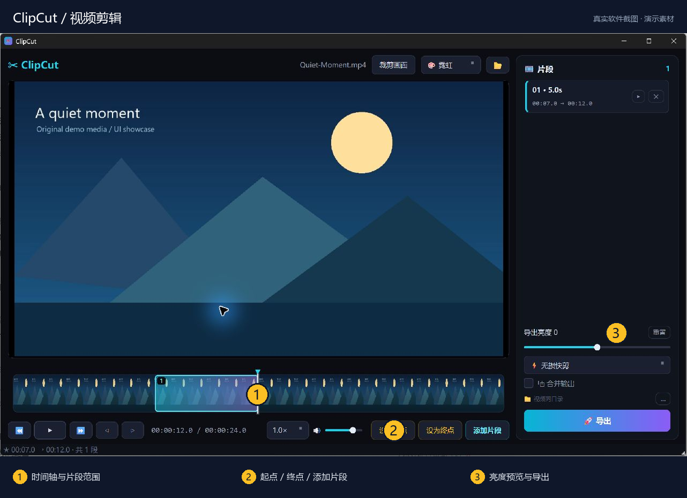
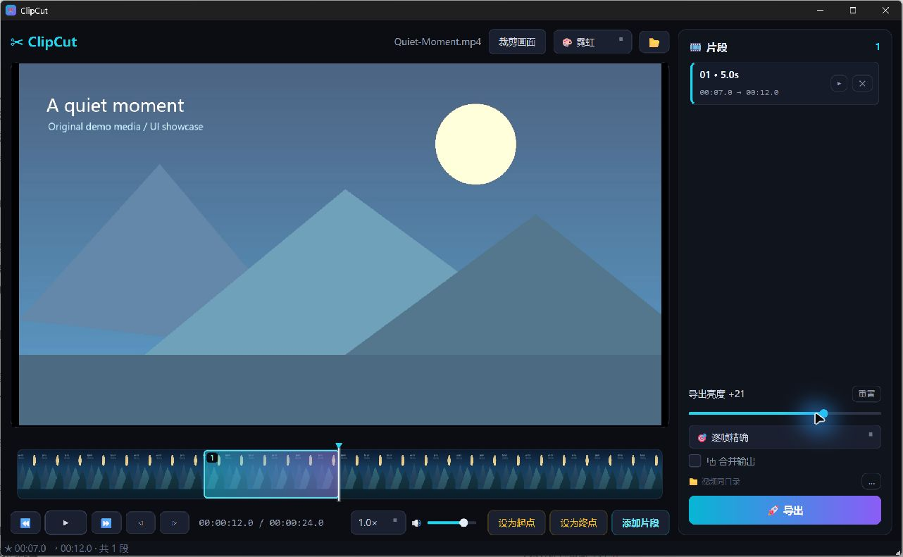
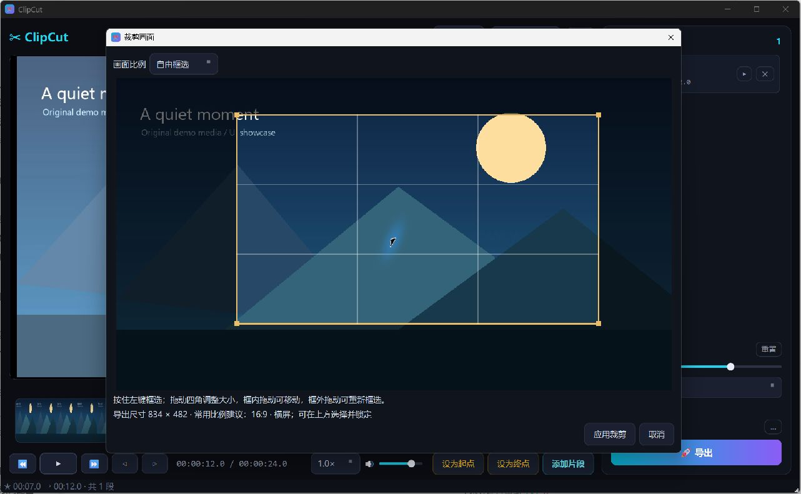

# ClipCut

**把视频剪成你需要的样子。**

片段剪辑 · 画面裁剪 · 亮度实时预览。

[下载 Windows 版本](https://github.com/lyboxly-Matrix/ClipCut/releases) · [亮点](#项目亮点) · [快速上手](#快速上手) · [使用与开发](#使用与开发) · [反馈问题](https://github.com/lyboxly-Matrix/ClipCut/issues)



> 截图来自实际运行的 Windows 发布版；文档、视频和音频均为原创演示素材。编号为介绍标注。

## 项目亮点

| 亮点 | 能帮你做什么 |
| --- | --- |
| **片段剪辑** | 为一个视频选取多个片段，分别保存或合成一段。 |
| **实时画面调整** | 裁剪和亮度直接反馈到主播放画面，播放、暂停和拖动进度时都能预览。 |
| **导出方式可选** | 无需画面调整时可无损快剪；需要精确切点或画面调整时使用重新编码。 |

## 跟着界面认识功能

### ① 在时间轴选片段，右侧集中管理

在底部定位画面，点击「设为起点」「设为终点」，再点「添加片段」。上图实际添加了一个 **00:07–00:12、共 5 秒**的片段；时间轴高亮范围与右侧片段卡片相互对应。可以继续添加片段，并选择分别导出或「合并输出」。

### ② 调整亮度，主画面立即反馈



右侧「导出亮度」滑块控制明暗，上图为 **+21** 的实际预览。拖动滑块时直接观察主画面，点击「重置」回到原亮度。非零亮度会使用重新编码导出。

### ③ 框选画面，按需要保留构图



点击顶部「裁剪画面」，在视频上拖出选区，拖动四角调整大小。弹窗显示网格、输出尺寸与比例建议；左上角可锁定常用比例，确认后点「应用裁剪」。裁剪与亮度可以叠加使用。

## 快速上手

下载 Windows ZIP 并完整解压 → 运行 `ClipCut.exe` → 拖入视频 → 设置片段 → 导出。

需安装 FFmpeg 与 FFprobe，或将它们放到 EXE 同目录；请保留程序旁的 `文件` 文件夹。

## 使用与开发

Windows 视频剪辑工具，使用 Python 3.11、PySide6 和 FFmpeg。

## 功能

- 手动设置起点、终点，添加多个片段，分别导出或合并。
- 无损快剪和重新编码的逐帧精确导出。
- 鼠标框选画面、移动选区、拖动四角调整大小。
- 锁定 16:9、9:16、1:1、4:3、4:5 或原画面比例；自由框选提供常用比例建议和输出尺寸。
- 裁剪实时应用到主播放画面，播放、暂停和拖动进度时均生效。
- 导出亮度滑动条（-50～+50），主画面即时预览，可与裁剪叠加；0 保持原亮度。

## 使用 Windows 版本

在本仓库 Releases 下载 Windows ZIP，完整解压后运行 `ClipCut.exe`。请保留旁边的 `文件` 文件夹。

需要在系统 PATH 中安装 FFmpeg 和 FFprobe，或将这两个程序放在 EXE 同目录。FFmpeg 下载与安装说明见 <https://ffmpeg.org/download.html>。

1. 打开或拖入视频。
2. 点击「设为起点」「设为终点」「添加片段」，再点击「导出」。
3. 如需裁剪，点击「裁剪画面」并框选，选择比例后应用。
4. 如需调亮或调暗，拖动右侧「导出亮度」滑动条；点击「重置」恢复原亮度。

有已添加的片段时，裁剪与亮度统一应用于这些片段；没有片段时，设置裁剪或亮度后可直接导出整段视频。打开另一视频时清除裁剪并恢复原亮度。

裁剪或非零亮度需要重新编码，输出 H.264 / AAC MP4。裁剪保持选区像素尺寸，不拉伸、不放大；坐标和尺寸对齐到偶数像素。无损快剪的起点可能对齐到较早的关键帧。

## 快捷键

| 快捷键 | 操作 |
| --- | --- |
| Space | 播放 / 暂停 |
| I / O | 设置起点 / 终点 |
| Enter | 添加片段 |
| ← / → | 后退 / 前进 5 秒 |
| , / . | 逐帧移动 |
| Delete | 删除选中的片段 |
| Esc | 清除时间打点 |
| Ctrl+O / Ctrl+E | 打开 / 导出 |

## 源码运行与构建

安装 Python 3.11，在仓库目录执行：

```powershell
python -m pip install -r requirements.txt
python main.py
```

Windows 打包可运行 `build.ps1`，脚本使用独立 `.buildenv` 环境，成功后生成 `dist\ClipCut\ClipCut.exe` 和 `dist\ClipCut\文件`。两者需一起分发。

源码入口为 `main.py`；界面在 `app.py`，裁剪选择在 `crop.py`，实时播放效果在 `video_view.py`，导出在 `workers.py`。

第三方依赖说明见 [THIRD_PARTY_NOTICES.md](THIRD_PARTY_NOTICES.md)。不包含自动开球识别功能、用户视频或导出结果。

